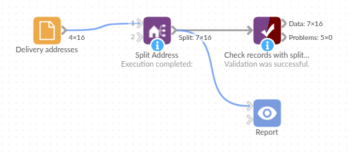

# Split Address

*Omniscope custom block · Preparation*

**Street and house number in one field, written street-first in some countries and number-first in others? Split them into street name, number and suffix, and see which addresses didn't fit.**

**Python** · pandas · nothing extra to install

## The problem it solves

A webshop that delivers across Europe keeps each customer's street and house number in one field, as the customer typed it: "Kerkstraat 12A" in Utrecht, "221B Baker Street" in London, "8, rue des Lilas" in Nantes. The carrier's upload file wants the street, the house number and the addition in separate fields.

This block splits each address into the three parts and reports how many it could not split.

- **16** customers in, **16** out, with three new fields
- **14** addresses split, street-first and number-first, including "Hauptstraße 5" and "Straße des 17. Juni 135"
- **1** number range ("12-14 Market Place") not recognised: left empty and counted in the block's message
- **1** missing address left empty

### How it works

- A list of patterns is tried in turn: street then number ("Kerkstraat 12A", "Baker Street, 221 B"), number then street ("221B Baker Street", "8, rue des Lilas").
- What follows the house number's digits is the suffix: `A`, `b`, `bis`, `1`, `2. tv`.
- An address with no pattern match gets empty fields; one with no number gets just the street name.

## What goes in

### Delivery addresses

16 invented customer addresses in eight countries, with the town and country already in fields of their own.

| Customer | Address | Town | Country |
|---|---|---|---|
| K-1001 | Kerkstraat 12A | Utrecht | Netherlands |
| K-1003 | Hauptstraße 5 | Freiburg | Germany |
| K-1005 | 221B Baker Street | London | United Kingdom |
| K-1008 | 8, rue des Lilas | Nantes | France |
| K-1010 | Molenweg 7 bis | Gent | Belgium |
| K-1013 | 12-14 Market Place | Ripon | United Kingdom |

*16 rows in the sample file.*

## The options

| Option | Demo setting | What it does |
|---|---|---|
| Address field | `Address` | The text field holding the street and house number. |
| Street name field | `Streetname` (default) | Name of the new field for the street name. |
| House number field | `Streetnumber` (default) | Name of the new field for the house number (text, digits only). |
| Suffix field | `Suffix` (default) | Name of the new field for what follows the number. |

## What comes out

### Split addresses (selected rows)

| Customer | Address | Streetname | Streetnumber | Suffix |
|---|---|---|---|---|
| K-1001 | Kerkstraat 12A | Kerkstraat | 12 | A |
| K-1002 | Prinsengracht 263-1 | Prinsengracht | 263 | 1 |
| K-1003 | Hauptstraße 5 | Hauptstraße | 5 | |
| K-1005 | 221B Baker Street | Baker Street | 221 | B |
| K-1008 | 8, rue des Lilas | rue des Lilas | 8 | |
| K-1010 | Molenweg 7 bis | Molenweg | 7 | bis |
| K-1012 | Bredgade 40, 2. tv | Bredgade | 40 | 2. tv |
| K-1013 | 12-14 Market Place | | | |
| K-1015 | Station Road | Station Road | | |
| K-1016 | Straße des 17. Juni 135 | Straße des 17. Juni | 135 | |

16 records. The block's message reads "1 of 15 addresses not recognised: their street name, number and suffix are empty."

**Formats it gets wrong.** A flat or unit before the number ("Flat 3, 12 High Street" gives the street "Flat"), a town or postcode after the street, and street names ending in numbers. The README lists each with its result. Keep towns and postcodes in fields of their own, and check the records whose street name is empty or unexpected.

## Where it pays off

### Logistics: Carrier uploads

Prepare delivery addresses for carriers and label printers that want the street and house number apart.

### Data quality: Address matching

Match customer addresses to a reference list or a previous delivery on street and number separately, so "Kerkstraat 12 A" and "Kerkstraat 12A" agree.

### Field service: Route planning

Sort visits by street and then by house number within the street.

### Public sector: Property registers

Bring addresses from forms into the street, number and addition structure that property and address registers use in many European countries.

*Use cases describe typical scenarios and are illustrative; the sample data is invented.*

## Why do this in Omniscope

- **From order export to carrier file.** The split fields go straight into the Field Organiser and the output block that writes the carrier's file, next to the orders.
- **Unsplit addresses caught on every run.** The block's message counts the addresses it could not split, and a Record filter on an empty street name gives the list to check by hand before the carrier file is written.
- **The patterns are in the script.** Each address format is one regular expression in the block's Python script, in the order tried; add one there for a format of your own, such as flats before the number.

## How it fits into an Omniscope workflow

Orders (File or Database) → **Split Address** → Validate data (street name present) → Field Organiser → Carrier upload file

Make sure the address field holds only the street and house number: split towns and postcodes off first (Split values on a comma, or UK Postcode Tools for UK postcodes).

## Try it

1. Open the demo project (`demo.iox` on the demo server, or import `demo.ioz` from this folder): 16 delivery addresses in eight countries.
2. The question: what are the street, house number and addition of each address?
3. Open Split Address: address field Address, new field names left at their defaults. Run it.
4. Look at the output: "Kerkstraat 12A" gives Kerkstraat, 12, A; "221B Baker Street" gives Baker Street, 221, B; "12-14 Market Place" is empty and the block's message counts it.
5. Filter the output on an empty Streetname: K-1013 (a number range) and K-1014 (no address) are the records to check by hand. K-1015, "Station Road", has a street name but no number.

## Running in Omniscope

*The demo project's workflow: the sample data, the block, and a Validate data check on its output.*

<!--language-->
## Language and libraries

Python. It uses pandas and the standard library's `re` module.

pandas is part of Omniscope's Python environment. It needs nothing else installed.
<!--/language-->

## Tested

The block is covered by automated tests that run its script against a stand-in for Omniscope's Python API: the sample addresses, every format listed in the README (supported and not), street names in other alphabets, numbers with a letter before the street, missing values, empty input, new field names, bad options, and 200,000 records.
