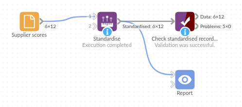

# Standardise

*Omniscope custom block · Preparation · Standardisation*

**Prices, percentages and days on one scorecard? Rescale each field to 0 to 1, lowest to highest, so they can be compared, weighted and added up.**

**R** · data.table · install data.table on the server's R if missing

## The problem it solves

A buyer compares twelve suppliers on price index (95 to 112), punctuality (85% to 99%), defects per thousand (0.6 to 5.6) and lead time (4 to 14 days). Added up as they are, the price index swamps everything else, and a chart of the four side by side is unreadable.

This block rescales each field to run from 0 (the supplier with the lowest value) to 1 (the highest), so every field counts on the same scale.

- **12** suppliers in, **12** out, the same fields in the same order
- **4** fields rescaled, each from exactly **0** to exactly **1**
- **1** missing punctuality figure left missing; the other eleven are still rescaled

### How it works

- For each chosen field: (value − lowest) / (highest − lowest).
- Missing values stay missing and are ignored when finding the lowest and highest.
- A field whose values are all the same becomes 0, and the block's message says so.

## What goes in

### Supplier scores

12 invented suppliers with four measures.

| Supplier | Category | Price | Punctuality | Defects | LeadTime |
|---|---|---|---|---|---|
| Northwind Fasteners | Hardware | 104.5 | 96.2 | 1.8 | 6 |
| Kestrel Plastics | Packaging | 112.3 | 88.0 | 0.9 | 12 |
| Fernhill Paper | Packaging | 95.4 | 97.8 | 2.4 | 5 |
| Marsh Lane Metals | Hardware | 101.2 | | 4.1 | 8 |
| Brookside Electrical | Electrical | 99.7 | 85.4 | 5.6 | 14 |
| Harbourside Labels | Packaging | 103.0 | 99.1 | 0.6 | 4 |

*12 rows in the sample file.*

## The options

| Option | Demo setting | What it does |
|---|---|---|
| Fields to standardise | `Price`, `Punctuality`, `Defects`, `LeadTime` | The number fields to rescale; each is replaced by its rescaled values. |

## What comes out

### Standardised records (selected rows, to three decimal places)

| Supplier | Price | Punctuality | Defects | LeadTime |
|---|---|---|---|---|
| Northwind Fasteners | 0.538 | 0.788 | 0.24 | 0.2 |
| Kestrel Plastics | 1 | 0.19 | 0.06 | 0.8 |
| Fernhill Paper | 0 | 0.905 | 0.36 | 0.1 |
| Marsh Lane Metals | 0.343 | | 0.7 | 0.4 |
| Brookside Electrical | 0.254 | 0 | 1 | 1 |
| Harbourside Labels | 0.45 | 1 | 0 | 0 |

12 records. Higher still means a higher value: Brookside's 1 for Defects is the most defects. For a score where 1 is best, take `1 - value` for Price, Defects and LeadTime in a formula.

## Where it pays off

### Procurement: Supplier scorecards

Put price, delivery, quality and lead time on one scale before weighting them into a score.

### Analytics: Before clustering or nearest neighbours

Stop a field with large numbers (revenue) outweighing one with small numbers (visits per week) in a distance-based method.

### Reporting: Comparing measures on one chart

Show several measures in different units on one axis, such as each store's sales, footfall and margin as a share of the range.

### HR and operations: Indices

Combine measures such as absence, overtime and turnover into an index per team or site.

*Use cases describe typical scenarios and are illustrative; the sample data is invented.*

## Why do this in Omniscope

- **Scores straight into the ranking.** The rescaled fields feed a Field Organiser formula for the weighted score and the Report's ranking table, straight from the supplier data.
- **The scale follows the data.** Each run rescales on the current lowest and highest values, so a new supplier or a new month's figures are placed on the same 0 to 1 range without editing anything.
- **A short R script.** The rescaling is a few lines of R in the block; open it in the block's editor to change the target range or flip a field so that lower is better.

## How it fits into an Omniscope workflow

Supplier data (File or Database) → **Standardise** → Field Organiser (score formula, `1 - value` for lower-is-better fields) → Sort → Report

Choose the number fields to rescale; the others pass through. The chosen fields are replaced: add a copy of each first (a formula field in Field Organiser) if the Report also needs the original values.

## Try it

1. Open the demo project (`demo.iox` on the demo server, or import `demo.ioz` from this folder): 12 suppliers with four measures.
2. The question: how do the suppliers compare on each measure, on one scale?
3. Open Standardise: fields Price, Punctuality, Defects and LeadTime. Run it.
4. Look at the output: each field runs from 0 to 1; Kestrel Plastics has the highest price (1) and Fernhill Paper the lowest (0); Marsh Lane Metals' punctuality stays empty.
5. Remove LeadTime from the fields and run again: LeadTime passes through as days.

## Running in Omniscope

*The demo project's workflow: the sample data, the block, and a Validate data check on its output.*

<!--language-->
## Language and libraries

R. It uses the data.table package.

data.table is not part of base R: install it on the Omniscope server's R if it is missing (`install.packages("data.table")`).
<!--/language-->

## Tested

The block is covered by automated tests that run its script against a stand-in for Omniscope's R API: the sample suppliers, missing values, fields whose values are all the same, whole numbers, negative numbers and field names with spaces, a field of only missing values, empty input, text fields, no fields, a missing field and no input, and 500,000 records.
