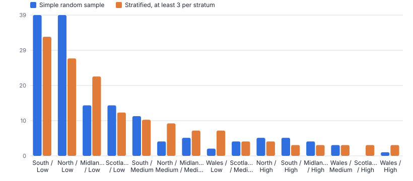
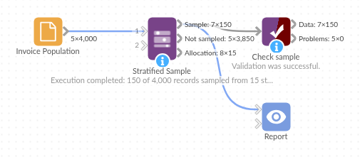

# Stratified Sample

*Omniscope custom block · Preparation*

**Random samples in which every group is represented: proportional with a minimum per stratum, equal, fixed or percentage, reproducible, with sampling weights.**

**Python** · pandas, numpy · nothing extra to install

## The problem it solves

Auditors, researchers and analysts sample all the time: invoices to test, customers to survey, stores for a trial, records for a manual quality check. A simple random sample of 150 from 4,000 invoices can easily contain no high-risk invoices from a small region at all, so conclusions about that group are impossible.

Stratified Sample draws the sample within groups, so every stratum is covered, and returns the weights needed to scale results back up to the population.

- **15** strata (region x risk band), all represented
- **1** stratum missed by a simple random sample of the same size
- **16** high-risk invoices in the sample
- **4,000** population reproduced by the sample weights

### How it works

- Choose the strata fields and the allocation: proportional to size (with a minimum per stratum), equal, a fixed number or a percentage per stratum.
- Set the sample size and a seed. The same seed always gives the same sample, so the selection can be documented and repeated.
- The sample output adds Sample Weight (population / sample size in the stratum) and the stratum label; the remainder output has every record not sampled.
- The allocation output shows population, sample size, sampling fraction and weight per stratum.

## What goes in

### Invoice population

4,000 synthetic invoices across 5 regions and 3 risk bands; high-risk invoices from Wales are rare.

| Invoice ID | Region | Risk Band | Supplier | Amount |
|---|---|---|---|---|
| INV-000001 | Wales | Low | SUP-066 | 105.2 |
| INV-000002 | South | Low | SUP-015 | 352.83 |
| INV-000003 | Wales | Low | SUP-210 | 298.98 |
| INV-000004 | North | Medium | SUP-294 | 963.41 |
| INV-000005 | South | Low | SUP-195 | 191.59 |
| INV-000006 | Midlands | Low | SUP-018 | 67.1 |

*4,000 rows in the sample file.*

## The options

| Option | Demo setting | What it does |
|---|---|---|
| Strata fields | `Region, Risk Band` | Sample within each combination of these fields. Leave empty for a simple random sample. |
| Total sample size | `150` | For proportional and equal allocation. |
| Minimum per stratum | `3` | Proportional allocation only: each stratum gets at least this many (or all its records, if fewer). |
| Allocation | `Total sample, proportional to stratum size` | How the sample is split between strata. |
| Random seed | `42` | The same seed always gives the same sample. |

## What comes out

### Allocation

| Region | Risk Band | Population | Sample Size | Sampling Fraction | Sample Weight | Share Of Population | Share Of Sample |
|---|---|---|---|---|---|---|---|
| Midlands | High | 71 | 3 | 0.042 | 23.67 | 0.018 | 0.02 |
| Midlands | Low | 618 | 22 | 0.036 | 28.09 | 0.154 | 0.147 |
| Midlands | Medium | 192 | 7 | 0.036 | 27.43 | 0.048 | 0.047 |
| North | High | 98 | 4 | 0.041 | 24.5 | 0.024 | 0.027 |
| North | Low | 757 | 27 | 0.036 | 28.04 | 0.189 | 0.18 |
| North | Medium | 245 | 9 | 0.037 | 27.22 | 0.061 | 0.06 |
| Scotland | High | 35 | 3 | 0.086 | 11.67 | 0.009 | 0.02 |
| Scotland | Low | 330 | 12 | 0.036 | 27.5 | 0.082 | 0.08 |
| Scotland | Medium | 109 | 4 | 0.037 | 27.25 | 0.027 | 0.027 |
| South | High | 84 | 3 | 0.036 | 28 | 0.021 | 0.02 |
| South | Low | 921 | 33 | 0.036 | 27.91 | 0.23 | 0.22 |
| South | Medium | 274 | 10 | 0.036 | 27.4 | 0.068 | 0.067 |
| Wales | High | 26 | 3 | 0.115 | 8.667 | 0.006 | 0.02 |
| Wales | Low | 182 | 7 | 0.038 | 26 | 0.046 | 0.047 |
| Wales | Medium | 58 | 3 | 0.052 | 19.33 | 0.014 | 0.02 |

### Sample

| Invoice ID | Region | Risk Band | Supplier | Amount | Sample Weight | Stratum |
|---|---|---|---|---|---|---|
| INV-000028 | Wales | Low | SUP-157 | 1,406.92 | 26 | Wales \| Low |
| INV-000049 | Scotland | Medium | SUP-108 | 1,782.64 | 27.25 | Scotland \| Medium |
| INV-000144 | South | Medium | SUP-105 | 610.33 | 27.4 | South \| Medium |
| INV-000152 | Scotland | Low | SUP-208 | 155.98 | 27.5 | Scotland \| Low |
| INV-000205 | Scotland | Low | SUP-209 | 249.47 | 27.5 | Scotland \| Low |
| INV-000311 | Midlands | High | SUP-032 | 201.22 | 23.67 | Midlands \| High |
| INV-000322 | South | Low | SUP-143 | 99.5 | 27.91 | South \| Low |
| INV-000324 | South | Medium | SUP-040 | 105.16 | 27.4 | South \| Medium |

*A simple random sample leaves small strata empty; the stratified sample covers all 15 with at least 3 records each (synthetic data).*

## Where it pays off

### Audit and compliance: Transaction testing

Select invoices, payments or journal entries for testing with every business unit and risk band covered, and a documented, repeatable selection.

### Market research: Survey panels

Draw survey invitations that match the customer base by region, age band or segment, with weights for analysis.

### Retail and marketing: Test and control groups

Pick trial stores or customers per format or region; the remainder output is the control group.

### Data science: Balanced training data

Equal allocation across classes for labelling or model training, keeping the rest for validation.

*Use cases describe typical scenarios and are illustrative.*

## Why do this in Omniscope

- **The draw and its record together.** The sample goes to the testers' file, the remainder serves as a control group, and the allocation output stays in the project as the record of how the sample was set.
- **Same seed, same invoices.** Re-running with the same seed draws the same sample, which the tests check, so the selection can be documented and repeated; the weights scale back to the 4,000-invoice population.
- **Allocation as a setting.** Proportional with a minimum, equal, fixed or percentage per stratum are options; a different allocation rule can be written into the block's script.

## How it fits into an Omniscope workflow

Population (Database) → **Stratified Sample** → Report / File output (selection)

Feed the full population. Send the Sample output to a file or email for the testers, keep the Allocation output as the sampling record.

For estimates, multiply each sampled finding by its Sample Weight and add up per stratum.

The draw runs between the population in the database and the testers' file, with the allocation output kept alongside as the record of how the sample was set.

## In one step

Proportional allocation with a minimum per stratum, equal allocation and sampling weights.

## Try it

1. Open the demo project (`demo.iox` on the demo server, or import `demo.ioz` from this folder): 4,000 invoices across regions and risk bands.
2. The question: if we test 150 invoices at random, how many high-risk invoices from Wales will we see? Possibly none.
3. Open Stratified Sample: strata Region and Risk Band, 150 in total, at least 3 per stratum, seed 42. Run it.
4. Look at the allocation output: every stratum covered, proportional otherwise, with weights. Look at the chart comparing it with a simple random sample.
5. Note the seed: rerun and you get the same selection, so the selection can be repeated and documented for audit.

## Running in Omniscope

*The demo project's workflow: the sample data, the block, and a Validate data check on its output.*

<!--language-->
## Language and libraries

Python. It uses pandas and numpy, plus the Python standard library (math).

pandas and numpy are part of Omniscope's Docker Python image, and the block was run in both host mode and Docker mode on an Omniscope server, with the same results. It needs nothing else installed.
<!--/language-->

## Tested

The demo workflow completed without errors on an Omniscope server (150 records in Sample, 3,850 in Not sampled and 15 in Allocation). Automated tests check normal data, empty input, wrong types and large input.
