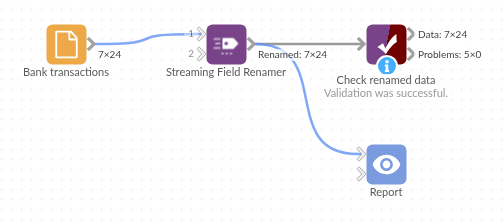

# Streaming Field Renamer

*Omniscope custom block · Preparation*

**One list of renames, written in the block or kept in a CSV file, applied to every export that needs them, however many records it has.**

**Python** · pandas · nothing extra to install

## The problem it solves

A bank's transaction export uses short technical names: `acct_no`, `txn_dt`, `dr_cr`, `amt_gbp`. Every project that reads the export needs the same readable names, and the exports can be large.

This block renames the fields from a list of rules, chunk by chunk, leaving the values alone.

- **24** transactions in, **24** out, values and types unchanged
- **8** rules: **7** rename a field, **1** (`branch_cd`) names a field this export doesn't have and is ignored
- **7** of **7** fields renamed

### How it works

- Write the rules in **Rename rules**, one per line or separated by semicolons (`acct_no = Account Number`), or leave it empty and choose a CSV file with the columns `Current Name` and `New Name`.
- Field names are matched exactly, including capitals; spaces at either end of a name in the file are ignored, and names are always read as text.
- Rules with an empty current name are skipped. A rule with no new name, a current name listed twice, or a rename that would give two fields the same name stops the block with a message saying which.

## What goes in

### Bank transactions

24 invented transactions on three business accounts.

| acct_no | txn_dt | txn_ref | dr_cr | amt_gbp | bal_gbp | mcc |
|---|---|---|---|---|---|---|
| 40-12-77 31845622 | 2025-05-01 | CARD Fuel North Road | DR | 60.99 | 2439.01 | 5541 |
| 40-12-77 51200981 | 2025-05-01 | FPO Rent Moor Lane | DR | 850.00 | 1650.00 | |
| 20-44-19 70033415 | 2025-05-02 | DD Pennine Water | DR | 30.55 | 2469.45 | 4900 |

*24 rows in the sample file.*

### Rename rules (also in `rename-rules.csv`)

| Current Name | New Name |
|---|---|
| acct_no | Account Number |
| txn_dt | Transaction Date |
| txn_ref | Reference |
| dr_cr | Debit or Credit |
| amt_gbp | Amount |
| bal_gbp | Balance |
| mcc | Merchant Category |
| branch_cd | Branch Code |

## The options

| Option | Demo setting | What it does |
|---|---|---|
| Rename rules | `acct_no = Account Number; txn_dt = Transaction Date; ...` (all 8 rules) | The rules, written in the block: Current Name = New Name, separated by semicolons or line breaks. |
| Rename rules CSV file | empty | The same rules as a CSV file (Current Name, New Name), used when Rename rules is empty. |

## What comes out

### Renamed data

| Account Number | Transaction Date | Reference | Debit or Credit | Amount | Balance | Merchant Category |
|---|---|---|---|---|---|---|
| 40-12-77 31845622 | 2025-05-01 | CARD Fuel North Road | DR | 60.99 | 2439.01 | 5541 |
| 40-12-77 51200981 | 2025-05-01 | FPO Rent Moor Lane | DR | 850.00 | 1650.00 | |
| 20-44-19 70033415 | 2025-05-02 | DD Pennine Water | DR | 30.55 | 2469.45 | 4900 |

24 records, the fields in their original order.

## Where it pays off

### Finance: Bank and card exports

Give each bank's or card provider's export the same readable names before the transactions are appended and reconciled.

### Large extracts: Logs and event data

Rename the fields of large extracts without holding them in memory at once.

### Several projects: One rules file

Point every project that reads a system's exports at the same rules file, and update the names once.

### System migrations: Old names to new

Rename the fields of an old system's extracts to the new system's names, so old and new data can be appended.

*Use cases describe typical scenarios and are illustrative; the sample data is invented.*

## Why do this in Omniscope

- **One file, many workflows**: kept as a CSV file beside the projects on the server, the rules are picked up by every workflow on its next run after a change, and the renamed fields go straight on to the Append, Join or Report that follows.
- **Fails loudly on a bad rule**: a rule with no new name, or a rename that would make two fields share a name, stops the block with a message saying which, so a scheduled run doesn't publish half-renamed data.
- **Streams in Python**: the block uses Omniscope's streaming API, so it holds one chunk at a time rather than the whole input; the script is about 75 lines in the block's editor, a starting point for other chunk-by-chunk changes.

## How it fits into an Omniscope workflow

Bank export (File) → **Streaming Field Renamer** → Append (other banks' exports, renamed the same way) → Report

## Try it

1. Open the demo project (`demo.iox` on the demo server, or import `demo.ioz` from this folder): 24 bank transactions, with the rules written in the block.
2. The question: can every project use the same readable names for this export?
3. Open Streaming Field Renamer: the eight rules are in **Rename rules**. Run it.
4. Look at the output: 24 records with all 7 fields renamed; the `branch_cd` rule is ignored because the export has no such field.
5. Delete `Amount` from the rule `amt_gbp = Amount` and run again: the block stops with "These rules have no new name: amt_gbp".

## Running in Omniscope

*The demo project's workflow: the sample data, the block, and a Validate data check on its output.*

<!--language-->
## Language and libraries

Python. It uses pandas.

pandas is part of Omniscope's Python environment. It needs nothing else installed.
<!--/language-->

## Tested

The block is covered by automated tests that run its script against a stand-in for Omniscope's Python API: the sample data, data in several chunks, the block closing after the stream, rules files with spaces after commas, capitals in headings and a byte order mark, exact matching and ignored rules, renames that would clash, swapped names, blank, incomplete and duplicate rules, names that look like numbers or placeholders, unreadable or wrong rules files, rules written in the block (the same result as the file, one per line, precedence over the file, mistakes), empty input, field types kept, and 200,000 records with 500 fields.
