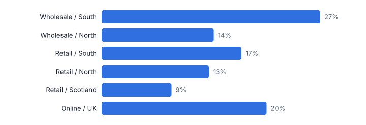
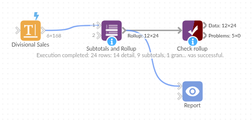

# Subtotals and Rollup

*Omniscope custom block · Preparation*

**Grouped totals with a subtotal at every level and a grand total, in report order with indented labels and shares of parent and total.**

**Python** · pandas, numpy · nothing extra to install

## The problem it solves

Management packs are full of tables with subtotals: sites within regions within divisions. Building one usually means aggregating at each level separately, appending the results and sorting them back into report order.

This block does it in one step for any number of levels and value fields, with row types, indented labels and shares, ready for a table in a Report or an export.

- **24** rows in the rolled-up table
- **9** subtotal rows
- **3** levels: Division, Region, Site
- **1** grand total row

### How it works

- Connect data, choose the group fields outermost first and the value fields.
- Choose the aggregation, how children are ordered, whether subtotals come before or after their children, and the total label.
- Output: one table with Order, the group fields, Level, Row Type, Label, Rows, the values and the shares.

## What goes in

### Divisional sales

Invented monthly revenue and margin for 14 sites.

| Division | Region | Site | Month | Revenue (GBP k) | Gross Margin (GBP k) |
|---|---|---|---|---|---|
| Retail | North | Leeds | 2025-01 | 73.1 | 19.1 |
| Retail | North | Leeds | 2025-02 | 218.6 | 69.6 |
| Retail | North | Leeds | 2025-03 | 88.4 | 34.4 |
| Retail | North | Leeds | 2025-04 | 98.4 | 35.1 |
| Retail | North | Leeds | 2025-05 | 99.7 | 36.4 |
| Retail | North | Leeds | 2025-06 | 116.9 | 45.8 |

*168 rows in the sample file.*

## The options

| Option | Demo setting | What it does |
|---|---|---|
| Group fields, outermost first | `Division, Region, Site` | For example Division, Region, Site. |
| Value fields | `Revenue (GBP k), Gross Margin (GBP k)` | The numbers to aggregate at every level. |
| Aggregate | `Sum` | How values are combined into subtotals. |
| Order children by | `First value, largest first` | Order of rows under each subtotal. |

## What comes out

### Rollup

| Label | Row Type | Level | Rows | Revenue (GBP k) | Gross Margin (GBP k) | Share Of Parent | Share Of Total |
|---|---|---|---|---|---|---|---|
| Total | Grand total | 0 | 168 | 30,463.40 | 9,985.50 |  | 1 |
| Wholesale | Subtotal | 1 | 36 | 12,394.30 | 4,221.10 | 0.407 | 0.407 |
| · South | Subtotal | 2 | 24 | 8,179.90 | 2,722.80 | 0.66 | 0.269 |
| · · Reading Depot | Detail | 3 | 12 | 4,094.70 | 1,374.10 | 0.501 | 0.134 |
| · · Southampton Depot | Detail | 3 | 12 | 4,085.20 | 1,348.70 | 0.499 | 0.134 |
| · North | Subtotal | 2 | 12 | 4,214.40 | 1,498.30 | 0.34 | 0.138 |
| · · Manchester Depot | Detail | 3 | 12 | 4,214.40 | 1,498.30 | 1 | 0.138 |
| Retail | Subtotal | 1 | 108 | 11,896.20 | 3,787.40 | 0.391 | 0.391 |
| · South | Subtotal | 2 | 48 | 5,248.80 | 1,693.30 | 0.441 | 0.172 |
| · · Brighton | Detail | 3 | 12 | 1,474.40 | 470 | 0.281 | 0.048 |
| · · Exeter | Detail | 3 | 12 | 1,306.50 | 413.70 | 0.249 | 0.043 |
| · · Oxford | Detail | 3 | 12 | 1,265.60 | 405.60 | 0.241 | 0.042 |
| · · Bristol | Detail | 3 | 12 | 1,202.30 | 404 | 0.229 | 0.039 |
| · North | Subtotal | 2 | 36 | 4,023.70 | 1,274.80 | 0.338 | 0.132 |
| · · Newcastle | Detail | 3 | 12 | 1,449.50 | 441.50 | 0.36 | 0.048 |
| · · Leeds | Detail | 3 | 12 | 1,294.10 | 421.70 | 0.322 | 0.042 |
| · · York | Detail | 3 | 12 | 1,280.10 | 411.60 | 0.318 | 0.042 |
| · Scotland | Subtotal | 2 | 24 | 2,623.70 | 819.30 | 0.221 | 0.086 |
| · · Edinburgh | Detail | 3 | 12 | 1,416.20 | 450.20 | 0.54 | 0.046 |
| · · Glasgow | Detail | 3 | 12 | 1,207.50 | 369.10 | 0.46 | 0.04 |
| Online | Subtotal | 1 | 24 | 6,172.90 | 1,977 | 0.203 | 0.203 |
| · UK | Subtotal | 2 | 24 | 6,172.90 | 1,977 | 1 | 0.203 |
| · · Web | Detail | 3 | 12 | 3,400.60 | 1,104.90 | 0.551 | 0.112 |
| · · App | Detail | 3 | 12 | 2,772.30 | 872.10 | 0.449 | 0.091 |

*The level 2 subtotals as shares of the grand total (illustrative figures).*

## Where it pays off

### Finance: Management accounts

Revenue, cost and margin by division, region and cost centre with subtotals, for the monthly pack.

### Retail: Store league tables

Sales by area and store, largest first within each area, with each store's share of its area.

### Public sector: Budget statements

Spend by directorate, service and budget line with subtotals and shares.

### Operations: Headcount and capacity

Headcount by function, team and grade with subtotals at each level.

*Use cases describe typical scenarios and are illustrative.*

## Why do this in Omniscope

- **From transactions to the pack table.** The block aggregates the transactions itself, and the Table view sorted by Order and the Excel output show the same rows in the same order.
- **Totals that reconcile.** The tests check that the detail rows add up to the grand total and that the division shares sum to 100%, so the subtotals match a table of the same data.
- **Layout as options.** Child order, subtotals before or after their children and the total label are settings, and Row Type drives the formatting in the Table view.

## How it fits into an Omniscope workflow

Transactions → **Subtotals and Rollup** → Report (Table view sorted by Order) / Excel output

Feed transactions directly; the block aggregates. Period Comparison can produce the period columns first.

Show the result in a Table view sorted by Order, formatting rows by Row Type, or export it to Excel.

## In one step

Every level, its subtotals and the grand total, already in report order.

## Try it

1. Open the demo project (`demo.iox` on the demo server, or import `demo.ioz` from this folder): invented monthly sales for 14 sites.
2. The question: can we have the divisional table with subtotals, as in the board pack?
3. Open the block: Division, Region, Site; Revenue and Margin; sum. Run it.
4. Look at the table: grand total, division and region subtotals, sites largest first, shares of parent.
5. Switch subtotals to after their children, or sort by name, to match the house style.

## Running in Omniscope

*The demo project's workflow: the sample data, the block, and a Validate data check on its output.*

<!--language-->
## Language and libraries

Python. It uses pandas and numpy.

pandas and numpy are part of Omniscope's Docker Python image, and the block was run in both host mode and Docker mode on an Omniscope server, with the same results. It needs nothing else installed.
<!--/language-->

## Tested

The demo workflow ran without errors on an Omniscope server, giving 24 records in Rollup. Automated tests cover normal data, empty input, wrong types and large input.
