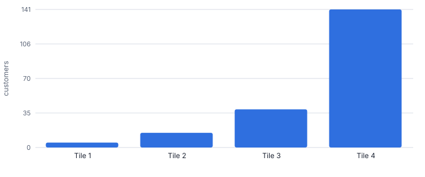
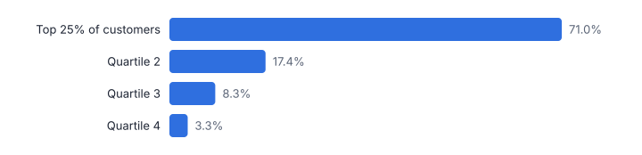
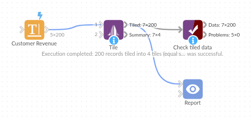

# Tile

*Omniscope custom block · Preparation*

**Quartiles, deciles, Pareto bands, standard-deviation bands or your own cut points, in one block and within groups if you like. Find out how few customers make most of the revenue.**

**Python** · pandas, numpy · nothing extra to install

## The problem it solves

Banding a measure is one of the most common steps in analysis: revenue deciles for targeting, Pareto bands for account management, price bands for range reviews, risk bands for credit. Equal-width buckets are easy with a formula, but quantiles and equal-sum bands need sorting, running totals and thresholds per group.

Tile does it in one step with five methods, and summarises each tile so the story is immediate.

- **5** customers make the first quarter of revenue
- **141** customers make the last quarter
- **71%** of revenue from the top 25% of customers
- **5** tiling methods

### How it works

- Pick the numeric field and a method: equal records (quantiles), equal sum, equal width, smart (standard deviations) or manual cut points.
- Set the number of tiles (4, 10, 100) and whether tile 1 holds the highest or the lowest values.
- Optionally tile within groups, such as deciles per region, so each region has its own top 10%.
- Each record gets Tile Number and Tile Range (smart tiles get a label such as *High*); the summary output gives counts, ranges, totals and shares per tile.

## What goes in

### Customer revenue

200 synthetic customers with a typical long-tailed revenue distribution.

| Customer ID | Region | Segment | Annual Revenue | Orders |
|---|---|---|---|---|
| CUST-0001 | North | Mid-market | 24384 | 18 |
| CUST-0002 | North | Mid-market | 6272 | 1 |
| CUST-0003 | Midlands | SME | 7680 | 6 |
| CUST-0004 | South | Enterprise | 8430 | 34 |
| CUST-0005 | Scotland | SME | 890 | 19 |
| CUST-0006 | Scotland | SME | 2380 | 56 |
| CUST-0007 | North | SME | 3360 | 47 |
| CUST-0008 | South | SME | 1170 | 3 |

*200 rows in the sample file.*

## The options

| Option | Demo setting | What it does |
|---|---|---|
| Value field | `Annual Revenue` | The numeric field to tile. |
| Method | `Equal sum (Pareto bands)` | How the tile boundaries are set. |
| Number of tiles | `4` | 4 for quartiles, 10 for deciles, 100 for percentiles. Not used by smart and manual tiles. |
| Tile 1 = highest values | `On` | Untick for tile 1 = lowest values. |

## What comes out

### Tiled data (highest revenue first)

| Customer ID | Region | Segment | Annual Revenue | Tile Number | Tile Range |
|---|---|---|---|---|---|
| CUST-0111 | North | SME | 263400 | 1 | 64,320 to 263,400 |
| CUST-0074 | North | Mid-market | 75888 | 1 | 64,320 to 263,400 |
| CUST-0159 | South | Enterprise | 66930 | 1 | 64,320 to 263,400 |
| CUST-0097 | North | Mid-market | 66096 | 1 | 64,320 to 263,400 |
| CUST-0078 | Scotland | SME | 64320 | 1 | 64,320 to 263,400 |
| CUST-0171 | Midlands | SME | 61100 | 2 | 19,740 to 61,100 |
| CUST-0169 | Midlands | Mid-market | 58944 | 2 | 19,740 to 61,100 |
| CUST-0088 | South | SME | 47470 | 2 | 19,740 to 61,100 |

### Tile summary: equal sum

| Tile Number | Records | Minimum | Maximum | Total | Share Of Total | Share Of Records |
|---|---|---|---|---|---|---|
| 1 | 5 | 64,320 | 263,400 | 536,634 | 0.252 | 0.025 |
| 2 | 15 | 19,740 | 61,100 | 527,200 | 0.248 | 0.075 |
| 3 | 39 | 9,280 | 18,256 | 536,110 | 0.252 | 0.195 |
| 4 | 141 | 800 | 9,230 | 527,718 | 0.248 | 0.705 |

### Tile summary: equal records (quartiles), for comparison

| Tile Number | Records | Minimum | Maximum | Total | Share Of Total | Share Of Records |
|---|---|---|---|---|---|---|
| 1 | 50 | 10,650 | 263,400 | 1,510,984 | 0.71 | 0.25 |
| 2 | 50 | 5,060 | 10,620 | 370,840 | 0.174 | 0.25 |
| 3 | 50 | 2,260 | 4,970 | 175,688 | 0.083 | 0.25 |
| 4 | 50 | 800 | 2,140 | 70,150 | 0.033 | 0.25 |

*Equal-sum tiles: a handful of customers make up the first quarter of revenue, while the last quarter needs most of the customer base (synthetic data).*

*Equal-record tiles (quartiles) tell the same story from the other side.*

## Where it pays off

### B2B sales: Account tiering

Equal-sum bands decide which accounts get a named account manager, which get inside sales and which go to self-service, and re-tier automatically each quarter.

### Retail and e-commerce: Customer deciles for targeting

Decile customers by spend within each region or channel, then target the top deciles with loyalty offers and the middle ones with reactivation campaigns.

### Financial services: Risk and balance bands

Manual cut points turn balances, loan-to-value or scores into the bands regulators and credit committees use, consistently across every report.

### Supply chain: Inventory value bands

Equal-sum tiles on stock value show the small set of lines that ties up most working capital (a quick start towards ABC classification).

*Use cases describe typical scenarios and are illustrative.*

## Why do this in Omniscope

- **Tiles as report filters.** Tile Number and Tile Range are ordinary fields, so choosing a band in the Report cuts every view to those customers, with the summary output beside them for the Pareto story.
- **Re-tiered from current data.** Bands are recomputed each time the workflow runs, so account tiers follow the quarter's revenue; the tests check that equal-sum bands hold equal shares.
- **Fixed bands where they must be.** Manual cut points keep regulatory or credit bands the same across reports, and the smart-tile labels such as High are in the block's script.

## How it fits into an Omniscope workflow

Customers (Database) → Aggregate (revenue per customer) → **Tile** → Report

Aggregate to one row per customer (or product, or store) first, then Tile. Join the tile back to transactions if you need it at row level.

Use the summary output directly in a Report for the Pareto story, and the tiled data for segment filters.

The tile fields can be used as filters and selections in the Report, so choosing a segment cuts every view to it.

## In one step

All the common tiling methods, plus tiling within groups and a ready-made summary.

## Try it

1. Open the demo project (`demo.iox` on the demo server, or import `demo.ioz` from this folder): 200 customers and their annual revenue.
2. The question: how many customers make up the first quarter of our revenue?
3. Open the Tile block: Annual Revenue, method Equal sum, 4 tiles, tile 1 = highest. Run it.
4. Look at the summary output: 5 customers make the first quarter of revenue and 141 make the last. That is the account-management conversation.
5. Switch the method to Equal records to get quartiles, or add Region as a group for deciles per region: one option, no formulas.

## Running in Omniscope

*The demo project's workflow: the sample data, the block, and a Validate data check on its output.*

<!--language-->
## Language and libraries

Python. It uses pandas and numpy, plus the Python standard library (re).

pandas and numpy are part of Omniscope's Docker Python image, and the block was run in both host mode and Docker mode on an Omniscope server, with the same results. It needs nothing else installed.
<!--/language-->

## Tested

The demo workflow runs without errors on an Omniscope server and produces 200 records in Tiled data and 4 in Tile summary. Its automated tests cover normal data, empty input, wrong types and large input.
