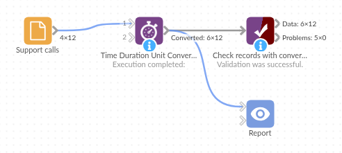

# Time Duration Unit Converter

*Omniscope custom block · Preparation*

**Durations typed as `0:04:35`, `12 min` and `1h 5m`, times stored as dates? Turn them into plain minutes (or seconds, or hours) that add up, average and compare with a target.**

**Python** · pandas · nothing extra to install

## The problem it solves

A support team logs each call's start time and how long it took. The start time is a date; the handling time was typed by whoever took the call: `0:04:35`, `12 min`, `1h 5m`, `PT18M`, `45 s`, `2h`. Total handling time per agent, or the share of calls handled within 15 minutes, can't be worked out until those are numbers in one unit.

This block adds a number field for each chosen field: the handling time in minutes, and the start time as minutes since midnight (for calls by time of day).

- **12** calls in, **12** out, with two new number fields
- **10** handling times read from **6** different styles of writing them
- **1** handling time that can't be read ("about 10 min") left empty and counted in the block's message
- **265.8** minutes of handling in all, ready to sum by agent

### How it works

- Date fields give the time since midnight; the date is ignored.
- Text is read as a duration: `0:04:35`, `08:30` (hours and minutes), `1 day 02:00:00`, `12 min`, `1h 5m`, `PT18M`.
- Each chosen field gets a new field with the unit added to its name (`Handling time_m`).

## What goes in

### Support calls

12 invented support calls over two days.

| Call | Agent | Started | Handling time |
|---|---|---|---|
| C-0401 | Priya | 2025-05-12 08:31:15 | 0:04:35 |
| C-0402 | Tom | 2025-05-12 08:47:00 | 12 min |
| C-0403 | Priya | 2025-05-12 09:05:40 | 1h 5m |
| C-0407 | Priya | 2025-05-12 13:15:30 | PT18M |
| C-0409 | Ana | 2025-05-12 15:12:00 | 45 s |
| C-0411 | Tom | 2025-05-13 08:05:00 | about 10 min |

*12 rows in the sample file.*

## The options

| Option | Demo setting | What it does |
|---|---|---|
| Fields to convert | `Started`, `Handling time` | Date fields (time since midnight) or text fields holding durations. |
| Unit | Minutes | Milliseconds, seconds, minutes or hours; its letter is added to each new field's name. |

## What comes out

### Converted records (selected rows)

| Call | Started | Handling time | Started_m | Handling time_m |
|---|---|---|---|---|
| C-0401 | 2025-05-12 08:31:15 | 0:04:35 | 511.25 | 4.58 |
| C-0402 | 2025-05-12 08:47:00 | 12 min | 527 | 12 |
| C-0403 | 2025-05-12 09:05:40 | 1h 5m | 545.67 | 65 |
| C-0406 | 2025-05-12 12:02:45 | | 722.75 | |
| C-0407 | 2025-05-12 13:15:30 | PT18M | 795.5 | 18 |
| C-0409 | 2025-05-12 15:12:00 | 45 s | 912 | 0.75 |
| C-0411 | 2025-05-13 08:05:00 | about 10 min | 485 | |
| C-0412 | 2025-05-13 10:30:00 | 2h | 630 | 120 |

12 records (minutes shown to two decimal places). The block's message reads "Not read as a time or duration (left empty): 1 in Handling time". By agent: Ana 128.6 minutes over 3 calls, Priya 96.6 over 4, Tom 40.7 over 3.

## Where it pays off

### Customer service: Handling and wait times

Turn typed or exported call, chat and ticket durations into minutes to report averages per agent and the share within target.

### Workforce: Timesheets

Add up hours worked from entries such as `7:30` or `7h 30m`, and compare them with contracted hours.

### Operations: Machine and process logs

Convert run times, downtime and cycle times logged in mixed formats into seconds for statistics and control charts.

### Sport and events: Results

Turn finishing times (`1:45:20.5`) into seconds to rank, average or chart them.

*Use cases describe typical scenarios and are illustrative; the sample data is invented.*

## Why do this in Omniscope

- **Typed durations to agent totals.** The minutes feed an Aggregate by agent and the Report's handling-time chart in the same workflow, straight from the call log.
- **Unreadable entries counted, not hidden.** Each run's message says how many durations could not be read, and they are left empty rather than set to zero, so they never drag down an average.
- **The duration rules are in the script.** Two-part times as hours and minutes, and bare numbers refused, are lines in the block's Python script; change them there if your logs use minutes and seconds.

## How it fits into an Omniscope workflow

Call log (File) → **Time Duration Unit Converter** → Aggregate (by Agent: sum and mean of Handling time_m) → Report

Choose the fields and one unit for all of them. To check that every duration was read, filter on an empty new field, or add a Validate data block that requires a value.

## Try it

1. Open the demo project (`demo.iox` on the demo server, or import `demo.ioz` from this folder): 12 support calls.
2. The question: how many minutes did each agent spend on calls?
3. Open Time Duration Unit Converter: fields Started and Handling time, unit Minutes. Run it.
4. Look at the output: `Handling time_m` holds 4.58 for `0:04:35`, 65 for `1h 5m` and 18 for `PT18M`; C-0411's "about 10 min" is empty, and the block's message says so.
5. Change the unit to Seconds and run again: the new fields are `Started_s` and `Handling time_s`, with 275 for `0:04:35`.

## Running in Omniscope

*The demo project's workflow: the sample data, the block, and a Validate data check on its output.*

<!--language-->
## Language and libraries

Python. It uses pandas.

pandas is part of Omniscope's Python environment. It needs nothing else installed.
<!--/language-->

## Tested

The block is covered by automated tests that run its script against a stand-in for Omniscope's Python API: the sample calls, each unit, missing dates, hours-and-minutes text, worded, clock-style and ISO durations, bare numbers, empty input, bad choices and missing fields, and 200,000 records.
