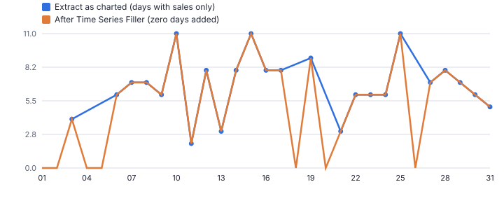
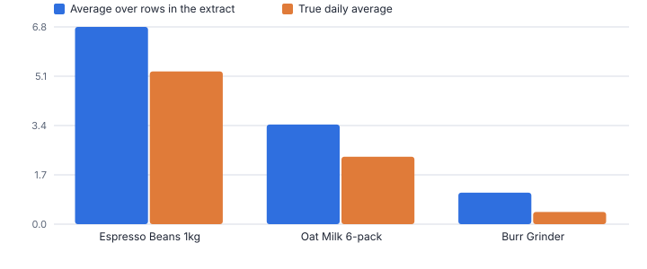
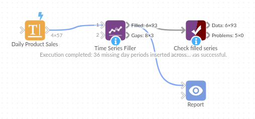

# Time Series Filler

*Omniscope custom block · Preparation*

**Put the missing days back. One row per day, week or month for every product, store or sensor, filled with zero, the last value or a straight line, so averages and charts tell the truth.**

**Python** · pandas, numpy · nothing extra to install

## The problem it solves

Sales, transaction and event extracts only contain the periods where something happened. A product with no sales on a Tuesday has no Tuesday row, so a daily average computed over the rows is really an average over *selling* days, line charts draw straight across the gaps, and forecasting blocks see a series that never touches zero.

Time Series Filler inserts every missing period in every series and fills it in the way that fits the measure: zero for sales, the previous value for prices or stock, interpolation for readings.

- **57 → 93** rows: 3 products x 31 days
- **36** missing days inserted
- **+158%** how much the grinder's daily average was overstated
- **4 days** longest gap found

### How it works

- Choose the date field, the series (such as Product, or Store and Product) and the period: hour, day, week, month, quarter or year.
- Choose the value fields and how to fill them: zero, previous value, linear interpolation or leave empty.
- Choose the span: each series from its own first to last period, all series aligned to the overall range, or a custom range (for example a full calendar year).
- Inserted rows are flagged with *Is Inserted* = 1, and other fields such as Category are carried across.
- The gap report shows the completeness of every series and its longest gap: a data-quality check in its own right.

## What goes in

### Daily product sales extract

57 rows: only the days on which each of three products sold, in October 2025 (synthetic).

| Date | Product | Category | Units Sold |
|---|---|---|---|
| 2025-10-03 | SKU-101 Espresso Beans 1kg | Coffee | 4 |
| 2025-10-06 | SKU-101 Espresso Beans 1kg | Coffee | 6 |
| 2025-10-07 | SKU-101 Espresso Beans 1kg | Coffee | 7 |
| 2025-10-08 | SKU-101 Espresso Beans 1kg | Coffee | 7 |
| 2025-10-09 | SKU-101 Espresso Beans 1kg | Coffee | 6 |
| 2025-10-10 | SKU-101 Espresso Beans 1kg | Coffee | 11 |
| 2025-10-11 | SKU-101 Espresso Beans 1kg | Coffee | 2 |
| 2025-10-12 | SKU-101 Espresso Beans 1kg | Coffee | 8 |

*57 rows in the sample file.*

## The options

| Option | Demo setting | What it does |
|---|---|---|
| Date field | `Date` | Date or date-time of each record. |
| Series (optional) | `Product` | One series per combination of these fields, such as Product or Store and Product. |
| Value fields to fill | `Units Sold` | Fields to fill in inserted rows. |
| Each series runs | `From the overall first to last period` | Where each series starts and ends: its own data, the whole dataset or a custom range. |
| One row per | `Day` | The period to insert missing rows at. |
| Fill with | `Zero` | What the value fields get in inserted rows. |

## What comes out

### Filled series (first days of the grinder)

| Date | Product | Category | Units Sold | Period | Is Inserted |
|---|---|---|---|---|---|
| 2025-10-01 | SKU-377 Burr Grinder | Coffee | 0 | 2025-10-01 | 1 |
| 2025-10-02 | SKU-377 Burr Grinder | Coffee | 1 | 2025-10-02 | 0 |
| 2025-10-03 | SKU-377 Burr Grinder | Coffee | 0 | 2025-10-03 | 1 |
| 2025-10-04 | SKU-377 Burr Grinder | Coffee | 0 | 2025-10-04 | 1 |
| 2025-10-05 | SKU-377 Burr Grinder | Coffee | 1 | 2025-10-05 | 0 |
| 2025-10-06 | SKU-377 Burr Grinder | Coffee | 1 | 2025-10-06 | 0 |
| 2025-10-07 | SKU-377 Burr Grinder | Coffee | 0 | 2025-10-07 | 1 |
| 2025-10-08 | SKU-377 Burr Grinder | Coffee | 2 | 2025-10-08 | 0 |
| 2025-10-09 | SKU-377 Burr Grinder | Coffee | 0 | 2025-10-09 | 1 |
| 2025-10-10 | SKU-377 Burr Grinder | Coffee | 0 | 2025-10-10 | 1 |

### Gap report

| Product | First Period | Last Period | Expected Periods | Periods Present | Periods Inserted | Longest Gap (periods) | Completeness |
|---|---|---|---|---|---|---|---|
| SKU-101 Espresso Beans 1kg | 2025-10-01 | 2025-10-31 | 31 | 24 | 7 | 2 | 0.774 |
| SKU-204 Oat Milk 6-pack | 2025-10-01 | 2025-10-31 | 31 | 21 | 10 | 2 | 0.677 |
| SKU-377 Burr Grinder | 2025-10-01 | 2025-10-31 | 31 | 12 | 19 | 4 | 0.387 |

*Charted from the extract, the line jumps straight from one selling day to the next and never shows the zero days; filled, the real pattern shows (synthetic data).*

*Averaging over the rows of an extract overstates daily sales for slow sellers most of all.*

## Where it pays off

### Retail and FMCG: Honest rate of sale

Fill zero-sale days per product and store before computing rate of sale, availability or forecasts, so slow lines are not flattered.

### Finance: Month-end balances and prices

Carry the last known balance, rate or price forward into months with no movement, so every account or instrument has a value for every period.

### Utilities and IoT: Meter and sensor gaps

Insert missed readings on a regular hourly grid and interpolate them, with the gap report flagging devices that went quiet.

### Web and product analytics: Daily active users per feature

Give every feature or page a row for every day, with zero usage where nothing happened, before charting trends and adoption curves.

*Use cases describe typical scenarios and are illustrative.*

## Why do this in Omniscope

- **Complete series into the forecast.** The filled output goes straight to Time Series Forecast or Multi-Row Formula, which expect every period to be present.
- **Feed completeness on each delivery.** The gap report gives each series' completeness and longest gap (4 days in the demo) and can feed a Validate data block; inserted rows are flagged Is Inserted, and integer values stay integers (tested).
- **A fill rule per measure.** Zero, previous value, interpolation or leave empty are options, with three span modes; the fill methods live in the Python script, open to one more.

## How it fits into an Omniscope workflow

Sales extract → Aggregate (per day and product) → **Time Series Filler** → Time Series Forecast → Report

Aggregate to one row per period and series first if the extract is at transaction level, then fill. The filled output is what native blocks such as Time Series Forecast and Multi-Row Formula expect.

Route the gap report to a Report tab or a Validate data block to monitor feed completeness.

The forecast is always built from a complete series, and the gap report shows how complete each delivery of the feed was.

## In one step

Several series at once, three span modes, a choice of fill method and a gap report.

## Try it

1. Open the demo project (`demo.iox` on the demo server, or import `demo.ioz` from this folder): a daily sales extract, but only 57 rows for 3 products over 31 days.
2. The question: what is the burr grinder's average daily sales? Averaging the rows gives an inflated answer, because the zero days are missing.
3. Open Time Series Filler: date, series = Product, one row per day, zero fill, aligned to the full month. Run it: 93 rows.
4. Look at the chart: before and after. The grinder's daily average was overstated by 158%.
5. Look at the gap report: completeness per product and the longest gap. This is also the shape Time Series Forecast needs.

## Running in Omniscope

*The demo project's workflow: the sample data, the block, and a Validate data check on its output.*

<!--language-->
## Language and libraries

Python. It uses pandas and numpy.

pandas and numpy are part of Omniscope's Docker Python image, and the block was run in both host mode and Docker mode on an Omniscope server, with the same results. It needs nothing else installed.
<!--/language-->

## Tested

On an Omniscope server the demo workflow ran cleanly: 93 records in Filled series and 3 in Gap report. The automated tests check normal data, empty input, wrong types and large input.
