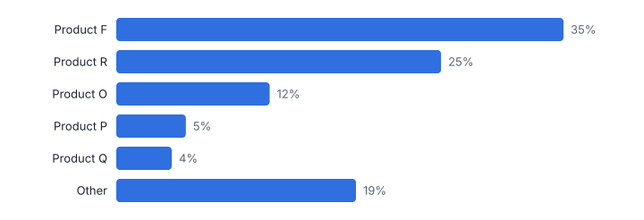
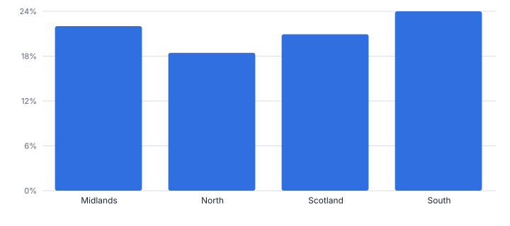
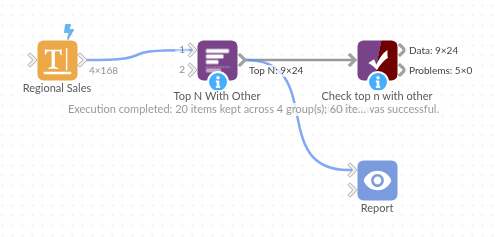

# Top N With Other

*Omniscope custom block · Preparation*

**Keep the top N items per group and roll the rest into Other, with ranks and shares, so every chart and table stays readable.**

**Python** · pandas, numpy · nothing extra to install

## The problem it solves

Twenty slices in a pie chart, or a bar chart with a long tail of tiny bars, hide the message. The usual fix, top N plus Other, takes sorting, sampling, summing the rest and appending it, per group.

This block does it in one step per group, carries other values (units, margin) along, and adds rank, share and cumulative share to every row.

- **20** products in each region (synthetic)
- **6** rows per region: top five and Other
- **22%** average share left in Other
- **1** step instead of sort, sample, summarise and union

### How it works

- Connect data with an item and a value, and optionally group fields and extra values to carry.
- Choose N, an optional minimum share, whether to add the Other row and its label.
- Output: the kept items and Other per group, with rank, values, share of group, cumulative share and items included.

## What goes in

### Regional sales

Synthetic sales lines for 20 products in four regions.

| Region | Product | Revenue (GBP) | Units |
|---|---|---|---|
| North | Product A | 1736.22 | 199 |
| North | Product B | 13436.14 | 109 |
| North | Product C | 7073.64 | 90 |
| North | Product C | 3622.18 | 80 |
| North | Product C | 7501.73 | 40 |
| North | Product D | 4344.4 | 34 |

*168 rows in the sample file.*

## The options

| Option | Demo setting | What it does |
|---|---|---|
| Item field | `Product` | For example Product or Supplier. |
| Rank by value | `Revenue (GBP)` | The number items are ranked on, such as revenue. |
| Per group (optional) | `Region` | For example Region. |
| Other values to carry (optional) | `Units` | Other numbers to total into the Other row alongside the ranking value. |
| Top N | `5` | 0 = no limit (use the minimum share). |
| Add an Other row | `On` | Adds a row totalling the items outside the top N. |

## What comes out

### Top five and Other (North and South)

| Region | Product | Rank | Revenue (GBP) | Units | Share Of Group | Cumulative Share | Items Included | Is Other |
|---|---|---|---|---|---|---|---|---|
| North | Product F | 1 | 414,095.41 | 252 | 0.347 | 0.347 | 1 | No |
| North | Product R | 2 | 300,898.11 | 223 | 0.252 | 0.598 | 1 | No |
| North | Product O | 3 | 142,110.74 | 27 | 0.119 | 0.717 | 1 | No |
| North | Product P | 4 | 63,968.72 | 161 | 0.054 | 0.771 | 1 | No |
| North | Product Q | 5 | 51,547.07 | 225 | 0.043 | 0.814 | 1 | No |
| North | Other | 6 | 222,294.09 | 3,014 | 0.186 | 1 | 15 | Yes |
| South | Product F | 1 | 217,782.82 | 244 | 0.278 | 0.278 | 1 | No |
| South | Product R | 2 | 134,686.53 | 39 | 0.172 | 0.45 | 1 | No |
| South | Product O | 3 | 126,235.37 | 15 | 0.161 | 0.612 | 1 | No |
| South | Product P | 4 | 80,945.37 | 326 | 0.103 | 0.715 | 1 | No |
| South | Product N | 5 | 33,761.30 | 300 | 0.043 | 0.758 | 1 | No |
| South | Other | 6 | 189,383.08 | 3,411 | 0.242 | 1 | 15 | Yes |

*A readable chart: five products and one Other slice (synthetic data).*

*How much each region's long tail holds.*

## Where it pays off

### Retail: Product mix charts

Top products per store or region with the rest as Other, for dashboards and board packs.

### Procurement: Spend by supplier

Top suppliers per category plus Other, or every supplier above 2% of spend.

### Marketing: Channels and campaigns

Top traffic sources per site with the long tail grouped.

### Finance: Customer revenue tables

Largest customers per business unit and the rest, with cumulative share.

*Use cases describe typical scenarios and are illustrative.*

## Why do this in Omniscope

- **The same Other row in every view.** Ranks and shares are worked out before the chart, so the pie, bar and table in the Report show the same Other row and shares, with ABC Classification or Concentration Measures alongside.
- **The tail re-counted each run.** As sales change, the top five per region, the Other total and the cumulative shares are recomputed from the sales lines, with Units carried into Other too.
- **Cut-off by count or share.** Top N, a minimum share and the Other label are options, and the ranking logic is in the block's script.

## How it fits into an Omniscope workflow

Data → **Top N With Other** → Report (pie, bar, table)

Run just before the chart; ABC Classification and Concentration Measures give the analysis behind the long tail.

Sort by Rank so Other always sits last.

## In one step

Top N per group with an Other row, shares and ranks.

## Try it

1. Open the demo project (`demo.iox` on the demo server, or import `demo.ioz` from this folder): synthetic sales of 20 products in four regions.
2. The question: can we show product mix per region without a 20-slice pie?
3. Run the block: top five per region plus Other.
4. Look at the chart, then switch to a minimum share of 5% instead of a fixed five.
5. Note that Units are summed into Other too.

## Running in Omniscope

*The demo project's workflow: the sample data, the block, and a Validate data check on its output.*

<!--language-->
## Language and libraries

Python. It uses pandas and numpy.

pandas and numpy are part of Omniscope's Docker Python image, and the block was run in both host mode and Docker mode on an Omniscope server, with the same results. It needs nothing else installed.
<!--/language-->

## Tested

Run on an Omniscope server, the demo workflow finished without errors (24 records in Top N with Other). Automated tests also cover normal data, empty input, wrong types and large input.
