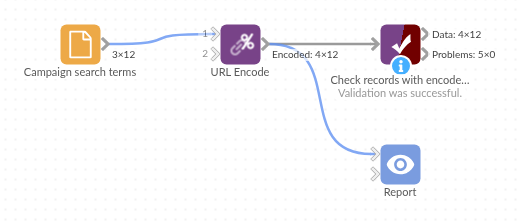

# URL Encode

*Omniscope custom block · Preparation*

**Building links from your data? Encode the search terms, names and parameters first, so spaces, `&`, `#` and accented letters don't break the link.**

**Python** · pandas · nothing extra to install

## The problem it solves

A marketing team wants a tracked search link for each campaign: `https://www.example.com/search?q=` followed by the campaign's search term. Pasting the term straight in works for "tea for two" in some browsers, but not for "fish & chips" (the `&` ends the search term), "Zoë's #1 pick" (the `#` cuts the link short), "C++ for beginners" (the `+` signs read as spaces) or "50% off" (`%` starts a code).

This block encodes each term into a new field, ready to join onto the start of the link.

- **12** search terms in, **12** records out
- **11** encoded, including `&`, `#`, `+`, `%`, `?`, `=`, `£` and accented letters
- **1** missing term left missing, not turned into the text "None"

### How it works

- Letters, digits and `_ . - ~` stay as they are; every other character becomes the `%` codes of its UTF-8 bytes (`é` is `%C3%A9`).
- Slashes are kept unless **Encode slashes** is ticked; **Spaces as +** gives the form style.
- The encoded text goes into a new field after the input fields, or replaces the field if given its name.

## What goes in

### Campaign search terms

12 invented campaign search terms, as typed by the campaign team.

| Campaign | Channel | Search term |
|---|---|---|
| SPR-01 | Email | café crème |
| SPR-02 | Email | fish & chips |
| SPR-04 | Social | C++ for beginners |
| SPR-07 | Display | Zoë's #1 pick |
| SPR-08 | Social | St Ives / Penzance |
| SPR-09 | Email | |

*12 rows in the sample file.*

## The options

| Option | Demo setting | What it does |
|---|---|---|
| Text to encode | `Search term` | The text field to encode. |
| Encoded field name | `Encoded term` | Name of the new field; give it the name of the field being encoded to replace that field. |
| Encode slashes | unticked | Tick to encode `/` as `%2F`, for text that goes into one part of a path. |
| Spaces as + | unticked | Tick for `+` instead of `%20` (form style). |

## What comes out

### Encoded records (selected rows)

| Campaign | Search term | Encoded term |
|---|---|---|
| SPR-01 | café crème | caf%C3%A9%20cr%C3%A8me |
| SPR-02 | fish & chips | fish%20%26%20chips |
| SPR-03 | 50% off | 50%25%20off |
| SPR-04 | C++ for beginners | C%2B%2B%20for%20beginners |
| SPR-07 | Zoë's #1 pick | Zo%C3%AB%27s%20%231%20pick |
| SPR-08 | St Ives / Penzance | St%20Ives%20/%20Penzance |
| SPR-09 | | |
| SPR-10 | size=10 & colour=blue | size%3D10%20%26%20colour%3Dblue |

12 records. A Field Organiser formula then joins `https://www.example.com/search?q=` and the Encoded term into a working link.

## Where it pays off

### Marketing: Tracked links

Build search, landing-page or tracking links per campaign, product or region from a table of terms.

### Reporting: Drill-through links

Add a link per record to a page in another system (a ticket, an order, a customer record) whose address includes a name or code with spaces or symbols.

### Integration: Web requests

Prepare the query values for a web request made later in the workflow, for example a search or lookup API that takes a name in its address.

### Data publishing: File and path names

Encode names used in download links or file paths, where `/` must be encoded too (tick Encode slashes).

*Use cases describe typical scenarios and are illustrative; the sample data is invented.*

## Why do this in Omniscope

- **Terms to clickable links in one workflow.** The encoded term feeds a Field Organiser formula that builds the link, and the Report shows it as a link next to the campaign's figures.
- **Links rebuilt with the data.** A new or edited search term gets its link on the next refresh, so the Report never shows a link someone made by hand from an older list.
- **Encoding choices in the block.** Slashes and the form-style `+` are settings; the encoding is Python's own `urllib.parse.quote` in a short script that you can open by unlocking the block's design.

## How it fits into an Omniscope workflow

Campaign terms (File) → **URL Encode** → Field Organiser (link formula) → Report

Connect the records holding the text, choose the field, and run. Encode only the values (the search term, the parameter), never a whole link: encoding `https://` turns the `:` and `/` into codes too.

## Try it

1. Open the demo project (`demo.iox` on the demo server, or import `demo.ioz` from this folder): 12 campaign search terms.
2. The question: what link should each campaign use?
3. Open URL Encode: field Search term, new field name Encoded term. Run it.
4. Look at the output: "fish & chips" becomes `fish%20%26%20chips`, "Zoë's #1 pick" becomes `Zo%C3%AB%27s%20%231%20pick`, and SPR-09 has no term and stays empty.
5. Tick Spaces as + and run again: spaces become `+`, and the `+` signs in "C++ for beginners" stay encoded as `%2B`.

## Running in Omniscope

*The demo project's workflow: the sample data, the block, and a Validate data check on its output.*

<!--language-->
## Language and libraries

Python. It uses pandas and the standard library's `urllib.parse`.

pandas is part of Omniscope's Python environment. It needs nothing else installed.
<!--/language-->

## Tested

The block is covered by automated tests that run its script against a stand-in for Omniscope's Python API: the sample terms, missing values, encoding slashes and spaces as `+`, naming and replacing the field, a clash with an existing field, values that are not text, empty input and bad options, and 200,000 records.
