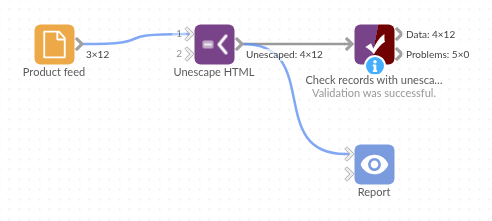

# Unescape HTML

*Omniscope custom block · Preparation*

**Text from a web feed reading `Caf&eacute; mugs &amp; saucers`? Turn the HTML references back into é, &, £ and the rest, so the text matches, sorts and reads as it should.**

**Python** · pandas · nothing extra to install

## The problem it solves

A homeware shop's product feed comes from its web platform with the titles HTML-escaped: `Caf&eacute; mugs &amp; saucers`, `Wool throw &pound;45 &rarr; &pound;39`, `Hose 15&nbsp;m &amp; reel`. In a report the titles look broken, a join to the stock list on title finds nothing, and a filter for "café" misses the mugs.

This block turns the references back into the characters they stand for, in a new field.

- **12** product titles in, **12** out
- **10** titles changed: named (`&eacute;`, `&pound;`, `&rarr;`), decimal (`&#8211;`) and hexadecimal (`&#x2615;`) references
- **2** non-breaking spaces turned into ordinary spaces, so "15 m" matches "15 m" elsewhere
- **1** double-escaped title (`&amp;amp;`) fixed by ticking one option

### How it works

- Every HTML5 named reference, and every decimal and hexadecimal one, is converted; text that is not a reference (`R&D`) is left alone.
- Non-breaking spaces become ordinary spaces (an option, ticked by default).
- Ticking **Repeat for double-escaped text** keeps unescaping until nothing changes.

## What goes in

### Product feed

12 invented product titles from a homeware shop's web platform.

| SKU | Category | Title |
|---|---|---|
| HB-101 | Kitchen | Caf&amp;eacute; mugs &amp;amp; saucers (set of 4) |
| HB-102 | Kitchen | Cast iron pan &amp;ndash; 28&amp;nbsp;cm |
| HB-105 | Home | Wool throw &amp;pound;45 &amp;rarr; &amp;pound;39 |
| HB-107 | Kitchen | Tea towels &amp;amp;amp; oven glove |
| HB-110 | Home | R&amp;D sample cushion |
| HB-111 | Kitchen | Espresso cups &amp;#x2615; x2 |

*12 rows in the sample file.*

## The options

| Option | Demo setting | What it does |
|---|---|---|
| Text to unescape | `Title` | The text field holding the escaped text. |
| Unescaped field name | `Clean title` | Name of the new field; give it the name of the field being unescaped to replace that field. |
| Repeat for double-escaped text | unticked | Tick to unescape until nothing changes (`&amp;lt;` to `<`). |
| Non-breaking spaces as plain spaces | ticked | `&nbsp;` becomes an ordinary space. |

## What comes out

### Unescaped records (selected rows)

| SKU | Title | Clean title |
|---|---|---|
| HB-101 | Caf&amp;eacute; mugs &amp;amp; saucers (set of 4) | Café mugs &amp; saucers (set of 4) |
| HB-102 | Cast iron pan &amp;ndash; 28&amp;nbsp;cm | Cast iron pan – 28 cm |
| HB-103 | Bird feeder &amp;quot;Robin&amp;quot; | Bird feeder "Robin" |
| HB-105 | Wool throw &amp;pound;45 &amp;rarr; &amp;pound;39 | Wool throw £45 → £39 |
| HB-107 | Tea towels &amp;amp;amp; oven glove | Tea towels &amp;amp; oven glove |
| HB-108 | Reading lamp &amp;lt;LED&amp;gt; | Reading lamp &lt;LED&gt; |
| HB-110 | R&amp;D sample cushion | R&amp;D sample cushion |
| HB-111 | Espresso cups &amp;#x2615; x2 | Espresso cups ☕ x2 |

12 records; HB-109 has no title and stays empty. HB-107 was escaped twice, so one pass leaves `&amp;`; with Repeat for double-escaped text ticked it reads "Tea towels &amp; oven glove".

## Where it pays off

### E-commerce: Product feeds

Clean product titles and descriptions from a web platform or marketplace export before matching them to stock, prices or a catalogue.

### Content and SEO: Page audits

Read page titles and meta descriptions from a crawl as they appear to visitors, and measure their length on the real characters.

### Customer feedback: Reviews and comments

Make review text from a website or app store export readable in a report, and searchable for words with accents.

### Integration: Web API responses

Unescape text fields from APIs and RSS feeds that return HTML-escaped strings.

*Use cases describe typical scenarios and are illustrative; the sample data is invented.*

## Why do this in Omniscope

- **Clean titles straight into the stock join.** The unescaped title feeds the Join to the stock list and the Report's product table, so "Café mugs & saucers" matches without a manual clean-up of each feed.
- **Every feed refresh cleaned the same way.** New products with new references are converted on the next run, and the tests pin the result for named, numeric and double-escaped references and for non-breaking spaces.
- **Choices the feed needs.** Double-escaped text and non-breaking spaces are settings; the conversion is Python's own `html.unescape` in a short script you can open and change in the block's editor.

## How it fits into an Omniscope workflow

Product feed (File or web connector) → **Unescape HTML** → Join (stock list, on Clean title) → Report

Connect the records, choose the field holding the escaped text, and run. If the output still holds `&amp;` or `&lt;`, the source was escaped twice: tick Repeat for double-escaped text.

## Try it

1. Open the demo project (`demo.iox` on the demo server, or import `demo.ioz` from this folder): 12 product titles from a web feed.
2. The question: what do the product titles actually say?
3. Open Unescape HTML: field Title, new field name Clean title. Run it.
4. Look at the output: "Café mugs & saucers (set of 4)", "Wool throw £45 → £39", and "R&D sample cushion" unchanged.
5. Tick Repeat for double-escaped text and run again: HB-107 becomes "Tea towels & oven glove".

## Running in Omniscope

*The demo project's workflow: the sample data, the block, and a Validate data check on its output.*

<!--language-->
## Language and libraries

Python. It uses pandas and the standard library's `html` module.

pandas is part of Omniscope's Python environment. It needs nothing else installed.
<!--/language-->

## Tested

The block is covered by automated tests that run its script against a stand-in for Omniscope's Python API: the sample titles, missing values, double-escaped text, non-breaking spaces, naming and replacing the field, a clash with an existing field, references without a semicolon, values that are not text, empty input and bad options, and 200,000 records.
