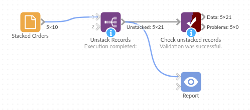

# Unstack Records

*Omniscope custom block · Preparation*

**Several values crammed into one cell, one per line? One record per value, with the rest of the record repeated, and several stacked fields kept in step.**

**Python** · pandas, numpy · nothing extra to install

## The problem it solves

Order systems, web forms and spreadsheets often export one record per order with the items stacked inside a cell: the products one per line, and their quantities one per line in the next cell. Those cells can't be counted, joined to a product list or charted until each value has a record of its own.

This block splits the chosen fields at the separator and writes one record per value, repeating the order number, customer and date on each.

- **10** orders in, **21** order lines out
- **2** stacked fields kept in step: each product next to its own quantity
- **1** order with a missing quantity: the gap is filled with an empty value, not shifted
- **1** order with no products kept as one record

### How it works

- Choose the fields to unstack and the separator: `\n` (a line break, the default), `\t` (a tab) or any text, matched exactly.
- Each record becomes as many records as its longest list; shorter lists are filled with empty values.
- The other fields are repeated and keep their types; the unstacked values are text.

## What goes in

### Stacked orders

10 invented orders from a garden supplies wholesaler, with the products and quantities stacked one per line.

| Order | Customer | Order Date | Products | Quantities |
|---|---|---|---|---|
| SO-2001 | Fernhill Garden Centre | 2025-03-03 | Terracotta pot 30cm Compost 50L Hand trowel | 12 20 6 |
| SO-2002 | Marsh Lane Hardware | 2025-03-03 | Hose reel | 4 |
| SO-2005 | Brookside Allotment Society | 2025-03-05 | Netting 4m Cane bundle | 15 |
| SO-2007 | Willow Bank Landscapes | 2025-03-07 | | |

*10 rows in the sample file.*

## The options

| Option | Demo setting | What it does |
|---|---|---|
| Fields to unstack | `Products`, `Quantities` | Text fields holding several values each, paired by position. |
| Separator | `\n` | The text between values: `\n` line break, `\t` tab, `\r` carriage return, or any text. |

## What comes out

### Unstacked records (selected orders)

| Order | Customer | Order Date | Products | Quantities |
|---|---|---|---|---|
| SO-2001 | Fernhill Garden Centre | 2025-03-03 | Terracotta pot 30cm | 12 |
| SO-2001 | Fernhill Garden Centre | 2025-03-03 | Compost 50L | 20 |
| SO-2001 | Fernhill Garden Centre | 2025-03-03 | Hand trowel | 6 |
| SO-2002 | Marsh Lane Hardware | 2025-03-03 | Hose reel | 4 |
| SO-2005 | Brookside Allotment Society | 2025-03-05 | Netting 4m | 15 |
| SO-2005 | Brookside Allotment Society | 2025-03-05 | Cane bundle | |
| SO-2007 | Willow Bank Landscapes | 2025-03-07 | | |

21 records in all. Order SO-2005 lists two products but one quantity, so Cane bundle's quantity is empty rather than taken from the next order.

## Where it pays off

### Sales operations: Order lines from order exports

Turn one-row-per-order exports into order lines to count units per product, or join to a product list for prices and categories.

### Surveys and forms: Multiple-choice answers

Split "tick all that apply" answers stored in one cell into one record per answer, to count how often each option was chosen.

### Service desks: Tags and assignees

Unstack tickets with several tags or assignees in one field, to report workload per tag or per person.

### Data from spreadsheets: Cells with line breaks

Clean up spreadsheets where several values were typed into one cell with line breaks.

*Use cases describe typical scenarios and are illustrative; the sample data is invented.*

## Why do this in Omniscope

- **Order lines ready for the product join.** Each new export is unstacked, its quantities turned to numbers in Field Organiser, and joined to the product list, so the per-product counts in the Report follow the latest file.
- **Lists stay in step.** A missing quantity becomes an empty value rather than shifting the next one up, an order with no products is kept, and the other fields keep their types; the tests cover these cases.
- **Any separator.** A line break, a tab or any text, matched exactly, is a setting; the splitting is a short pandas script in the block.

## How it fits into an Omniscope workflow

Order export (File) → **Unstack Records** → Field Organiser (Quantities to a number) → Join (product list) → Report

The unstacked values are text, so convert numbers with Field Organiser before adding them up.

## Try it

1. Open the demo project (`demo.iox` on the demo server, or import `demo.ioz` from this folder): 10 orders with stacked products and quantities.
2. The question: how many of each product were ordered?
3. Open Unstack Records: fields Products and Quantities, separator `\n`. Run it.
4. Look at the output: 21 records, one per product, each with its own quantity, and SO-2005's Cane bundle with an empty quantity.
5. Untick Quantities and run again: the products are still split, and the quantities cell is repeated whole on each record.

## Running in Omniscope

*The demo project's workflow: the sample data, the block, and a Validate data check on its output.*

<!--language-->
## Language and libraries

Python. It uses pandas and numpy.

pandas and numpy are part of Omniscope's Python environment. It needs nothing else installed.
<!--/language-->

## Tested

The block is covered by automated tests that run its script against a stand-in for Omniscope's Python API: the sample data, one or two fields, other separators, records with only missing values, field types kept, empty input, non-text fields and bad options, an input holding only the chosen field, and 200,000 records.
