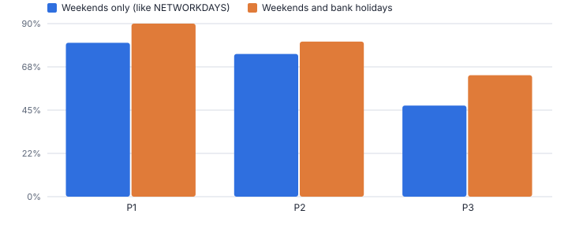
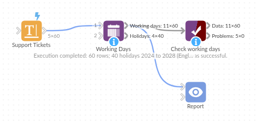

# Working Days

*Omniscope custom block · Preparation*

**Working days and due dates that know about bank holidays: SLA checks, delivery promises and payment terms that are right at Easter and Christmas too.**

**Python** · pandas, numpy · nothing extra to install

## The problem it solves

Service levels, delivery promises, payment terms and statutory deadlines are set in working days. Counting weekdays is easy, but bank holidays move every year, differ between England, Scotland and Northern Ireland, and occasionally change by proclamation, so an SLA report built on weekdays alone flags breaches that are not breaches.

Working Days generates the public holidays by rule for any year (including the one-off UK days), lets you add company closures, and returns working-day counts, due dates and an SLA verdict per row.

- **60** support tickets checked
- **6** tickets wrongly flagged as breached when holidays are ignored
- **8** England and Wales bank holidays in 2025
- **4** holiday calendars: E&W, Scotland, NI, US

### How it works

- Pick the start date and, to count, the end date; to add, a field (or fixed number) of working days.
- Choose the public holiday calendar and weekend, and list any extra closure dates.
- Each row gets Working Days and Calendar Days (when counting), a Due Date (when adding) and, with both, Met Target and Working Days Late.
- The holiday calendar used is a second output, so it can be checked, shared or joined to other data.

## What goes in

### Support tickets

60 synthetic tickets raised around Easter, early May and Christmas 2025, with dates written day first and an SLA in working days per priority.

| Ticket ID | Priority | Raised | Resolved | SLA Working Days |
|---|---|---|---|---|
| INC-5000 | P1 | 22/12/2025 | 23/12/2025 | 1 |
| INC-5001 | P2 | 26/12/2025 | 26/12/2025 | 3 |
| INC-5002 | P2 | 05/05/2025 | 07/05/2025 | 3 |
| INC-5003 | P3 | 02/05/2025 | 09/05/2025 | 5 |
| INC-5004 | P3 | 17/12/2025 | 28/12/2025 | 5 |
| INC-5005 | P3 | 23/04/2025 | 08/05/2025 | 5 |
| INC-5006 | P2 | 03/05/2025 | 11/05/2025 | 3 |
| INC-5007 | P1 | 15/04/2025 | 17/04/2025 | 1 |

*60 rows in the sample file.*

## The options

| Option | Demo setting | What it does |
|---|---|---|
| Start date | `Raised` | For example the date a ticket was raised or an order placed. |
| End date (to count working days) | `Resolved` | For example the date it was resolved or delivered. |
| Working days to add (field) | `SLA Working Days` | A number of working days per row, such as the SLA for its priority. |
| Public holidays | `England and Wales` | Public holidays that are not working days. |
| Count the start day | `On` | Ticked: Monday to Friday of the same week is 5 working days. Unticked: 4. |
| Weekend | `Saturday and Sunday` | Days that are not working days. |

## What comes out

### Tickets with working days, due date and SLA result

| Ticket ID | Priority | Raised | Resolved | SLA Working Days | Start Is Working Day | Working Days | Calendar Days | Due Date | Met Target | Working Days Late |
|---|---|---|---|---|---|---|---|---|---|---|
| INC-5000 | P1 | 22/12/2025 | 23/12/2025 | 1 | Yes | 2 | 1 | 2025-12-23 | Yes | 0 |
| INC-5001 | P2 | 26/12/2025 | 26/12/2025 | 3 | No | 0 | 0 | 2026-01-02 | Yes | 0 |
| INC-5002 | P2 | 05/05/2025 | 07/05/2025 | 3 | No | 2 | 2 | 2025-05-09 | Yes | 0 |
| INC-5003 | P3 | 02/05/2025 | 09/05/2025 | 5 | Yes | 5 | 7 | 2025-05-12 | Yes | 0 |
| INC-5004 | P3 | 17/12/2025 | 28/12/2025 | 5 | Yes | 6 | 11 | 2025-12-24 | No | 1 |
| INC-5005 | P3 | 23/04/2025 | 08/05/2025 | 5 | Yes | 11 | 15 | 2025-04-30 | No | 5 |
| INC-5006 | P2 | 03/05/2025 | 11/05/2025 | 3 | No | 4 | 8 | 2025-05-09 | No | 1 |
| INC-5007 | P1 | 15/04/2025 | 17/04/2025 | 1 | Yes | 3 | 2 | 2025-04-16 | No | 1 |

### Tickets that only pass once bank holidays are counted

| Ticket ID | Priority | Raised | Resolved | SLA Working Days | Start Is Working Day | Working Days | Calendar Days | Due Date | Met Target | Working Days Late |
|---|---|---|---|---|---|---|---|---|---|---|
| INC-5017 | P3 | 19/12/2025 | 27/12/2025 | 5 | Yes | 4 | 8 | 2025-12-30 | Yes | 0 |
| INC-5022 | P1 | 24/12/2025 | 26/12/2025 | 1 | Yes | 1 | 2 | 2025-12-29 | Yes | 0 |
| INC-5025 | P3 | 14/04/2025 | 23/04/2025 | 5 | Yes | 6 | 9 | 2025-04-23 | Yes | 0 |
| INC-5028 | P3 | 24/12/2025 | 05/01/2026 | 5 | Yes | 6 | 12 | 2026-01-05 | Yes | 0 |
| INC-5041 | P2 | 27/12/2025 | 02/01/2026 | 3 | No | 4 | 6 | 2026-01-02 | Yes | 0 |
| INC-5045 | P2 | 25/12/2025 | 02/01/2026 | 3 | No | 4 | 8 | 2026-01-02 | Yes | 0 |

### Holiday calendar (2025)

| Date | Holiday | Region | Weekday |
|---|---|---|---|
| 2025-01-01 | New Year's Day | ENGLAND_WALES | Wednesday |
| 2025-04-18 | Good Friday | ENGLAND_WALES | Friday |
| 2025-04-21 | Easter Monday | ENGLAND_WALES | Monday |
| 2025-05-05 | Early May bank holiday | ENGLAND_WALES | Monday |
| 2025-05-26 | Spring bank holiday | ENGLAND_WALES | Monday |
| 2025-08-25 | Summer bank holiday | ENGLAND_WALES | Monday |
| 2025-12-25 | Christmas Day | ENGLAND_WALES | Thursday |
| 2025-12-26 | Boxing Day | ENGLAND_WALES | Friday |

*Ignoring bank holidays understates SLA performance over Easter and Christmas (synthetic data).*

## Where it pays off

### IT and customer service: SLA reporting

Resolution time in working days per ticket, due dates by priority, and breach reports that take bank holidays into account.

### Logistics and retail: Delivery promises

Promise dates of order date plus N working days, per carrier calendar, and on-time delivery measured the same way.

### Finance and legal: Payment terms and deadlines

Invoice due dates in working days, statutory response deadlines (for example 20 working days) and ageing reports that respect bank holidays.

### HR and public sector: Leave and casework

Working days of leave between two dates, and casework timescales by nation: Scotland and Northern Ireland have different holidays.

*Use cases describe typical scenarios and are illustrative.*

## Why do this in Omniscope

- **Dashboard and exceptions agree.** Met Target aggregated by team and a filter on Working Days Late come from the same block, and the Holiday calendar output can mark holidays on another chart in the project.
- **Holidays by rule, checked against known years.** The tests check the generated calendars against known dates for England and Wales, Scotland, Northern Ireland and the US, including holidays moved off a weekend; 6 demo tickets are only shown as met once bank holidays are counted.
- **Your closures and new holidays.** Company closure dates are an option, and the UK one-off days are a list in the Python script where a newly announced holiday can be added.

## How it fits into an Omniscope workflow

Tickets / orders → **Working Days** → Aggregate (SLA % by team) → Report

Place it after the data with the dates. Aggregate Met Target by team or priority for an SLA dashboard; filter Working Days Late above zero for an exceptions list.

Reuse the Holiday calendar output elsewhere, for example to mark holidays on a trading chart.

## In one step

Omniscope's NETWORKDAYS formula counts weekdays; this block adds holiday calendars, due dates and SLA checks without maintaining a holiday table.

## Try it

1. Open the demo project (`demo.iox` on the demo server, or import `demo.ioz` from this folder): support tickets with raised and resolved dates and an SLA in working days.
2. The question: how many tickets breached SLA over Easter and Christmas? Weekday arithmetic says more than really did.
3. Open Working Days: start Raised, end Resolved, days to add SLA Working Days, England and Wales calendar. Run it.
4. Look at Due Date, Met Target and Working Days Late, then the chart: 6 tickets would be wrongly reported as breached if bank holidays were ignored.
5. Switch the calendar to Scotland, or add the office's Christmas shutdown dates, and rerun.

## Running in Omniscope

*The demo project's workflow: the sample data, the block, and a Validate data check on its output.*

<!--language-->
## Language and libraries

Python. It uses pandas and numpy, plus the Python standard library (datetime, re).

pandas and numpy are part of Omniscope's Docker Python image, and the block was run in both host mode and Docker mode on an Omniscope server, with the same results. It needs nothing else installed.
<!--/language-->

## Tested

The demo workflow runs without errors on an Omniscope server and produces 60 records in Working days and 40 in Holiday calendar. Its automated tests cover normal data, empty input, wrong types and large input.
